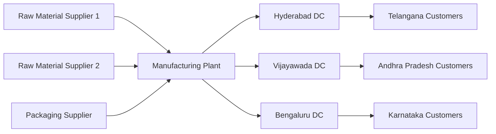
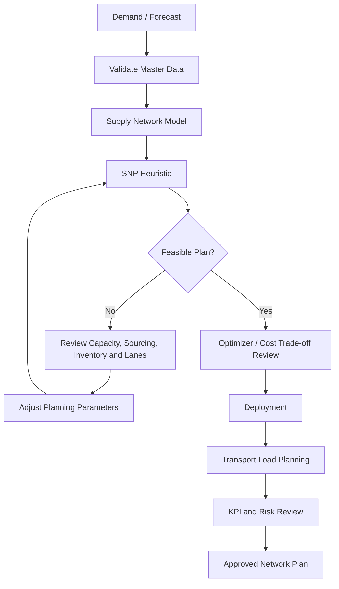

# SAP SCM Supply Chain Network Planning

## Week 1 Internship Project

## Six-Assessment Portfolio Navigation

This assessment is part of my six-assessment SAP SCM internship portfolio. The series is structured as one connected learning journey from network planning through performance improvement.

| Week | Assessment | Repository |
|---|---|---|
| 1 | Supply Chain Network Planning | [Open Week 1](https://github.com/hrudhaipremkumarpatwari/SAP-SCM-Supply-Chain-Network-Planning) |
| 2 | Master Data & Inventory Optimization | [Open Week 2](https://github.com/hrudhaipremkumarpatwari/SAP-SCM-Master-Data-Inventory-Optimization) |
| 3 | Logistics & Distribution Network Design | [Open Week 3](https://github.com/hrudhaipremkumarpatwari/SAP-SCM-Logistics-Distribution-Network-Design) |
| 4 | Production Planning & Scheduling Analysis | [Open Week 4](https://github.com/hrudhaipremkumarpatwari/SAP-SCM-Week4-Production-Planning-Scheduling-Analysis) |
| 5 | Supply Chain Integration & Collaboration | [Open Week 5](https://github.com/hrudhaipremkumarpatwari/SAP-SCM-Week5-Supply-Chain-Integration-Collaboration) |
| 6 | Performance Evaluation & Continuous Improvement | [Open Week 6](https://github.com/hrudhaipremkumarpatwari/SAP-SCM-Week6-Performance-Evaluation-Continuous-Improvement) |

**Central portfolio hub:** [SAP-SCM-Internship-Portfolio](https://github.com/hrudhaipremkumarpatwari/SAP-SCM-Internship-Portfolio) — the central index for the complete series.


This repository documents a **Supply Chain Network Planning simulation using SAP SCM / SAP APO Supply Network Planning (SNP) concepts**. The project is designed around a fictional but realistic Indian food-manufacturing company and demonstrates how supply, production, warehousing, transportation, and distribution decisions can be modeled in a structured SAP SCM planning approach.

> **Project type:** Conceptual SAP SCM network-planning and configuration blueprint. It is not presented as a live production-system implementation.

## Final Report

📄 **[Download / View the Final Week 1 SAP SCM Report (.docx)](docs/SAP_SCM_Week1_Supply_Chain_Network_Planning_Hrudhai_Final.docx)**

The Word document above is the final reviewed internship submission report for this project.

## Project Objective

The objective is to design an efficient end-to-end supply chain network and explain how SAP SCM/APO planning concepts can support:

- supplier and sourcing decisions
- plant and resource-capacity planning
- inventory positioning
- regional distribution planning
- transportation-lane design
- demand and supply balancing
- deployment and replenishment
- risk identification and contingency planning

## Business Scenario

The fictional company used in this project is **Deccan Harvest Foods Pvt. Ltd.**, a packaged millet-based ready-to-cook food manufacturer serving markets in Telangana, Andhra Pradesh, and Karnataka.

The modeled network contains:

- raw-material suppliers
- packaging suppliers
- one manufacturing plant
- regional distribution centers
- customer / market zones
- transportation lanes connecting the network

The planning goal is to maintain customer service while controlling inventory, transport cost, sourcing risk, and capacity constraints.

## Supply Chain Network



A detailed network diagram is available in [`diagrams/supply-chain-network.md`](diagrams/supply-chain-network.md).

## SAP SCM / APO Concepts Applied

| Area | Concepts used in the project |
|---|---|
| Master Data | Locations, products, location-products, resources |
| Sourcing | Production sources, procurement relationships, quota arrangements |
| Transportation | Transportation lanes, transit times, capacities and costs |
| Planning Structure | Supply chain model, planning version, planning area and planning book |
| Supply Planning | SNP heuristic and constrained planning logic |
| Optimization | Cost/capacity trade-off concepts using SNP optimizer principles |
| Distribution | Deployment and replenishment concepts |
| Transportation Planning | Transport Load Builder (TLB) concepts |
| Risk Management | Supplier, transport, demand, capacity, data and integration risks |

## Configuration Blueprint

The project follows this logical configuration sequence:

1. Define planning scope and assumptions.
2. Create / validate locations.
3. Create products and location-products.
4. Define production, storage, and transportation resources.
5. Maintain production or procurement sources.
6. Create transportation lanes between valid source and destination locations.
7. Define quota arrangements or sourcing priorities where required.
8. Assign objects to the supply chain model.
9. Create and activate the planning version.
10. Prepare planning area / planning book structures.
11. Load or simulate demand requirements.
12. Run an initial SNP heuristic planning cycle.
13. Review shortages, excess inventory, resource overloads, and lane constraints.
14. Evaluate constrained/cost-based alternatives using optimizer concepts.
15. Perform deployment logic for downstream allocation.
16. Review transportation consolidation using TLB concepts.
17. Validate the plan against KPIs and risk scenarios.

See [`docs/configuration-checklist.md`](docs/configuration-checklist.md) for the project checklist.

## Planning Flow



A separate version is available in [`diagrams/planning-flow.md`](diagrams/planning-flow.md).

## Key Planning KPIs

The design evaluates the network using indicators such as:

- customer service / order-fill performance
- inventory coverage and safety stock
- capacity utilization
- supplier dependency
- transport lead time
- transportation utilization
- stockout / shortage frequency
- excess inventory
- planning-data accuracy

## Risk and Contingency Areas

The project analyzes risks including supplier disruption, plant downtime, unexpected demand spikes, transportation delays, packaging shortages, capacity bottlenecks, incorrect master data, and integration failures.

Detailed mitigations are documented in [`docs/risk-and-validation.md`](docs/risk-and-validation.md).

## Repository Structure

```text
SAP-SCM-Supply-Chain-Network-Planning/
|
|-- README.md
|-- docs/
|   |-- SAP_SCM_Week1_Supply_Chain_Network_Planning_Hrudhai_Final.docx
|   |-- assessment-overview.md
|   |-- network-plan.md
|   |-- configuration-checklist.md
|   |-- risk-and-validation.md
|   `-- portal-submission-description.md
|
`-- diagrams/
    |-- supply-chain-network.md
    `-- planning-flow.md
```

## Deliverables

- final Week 1 Word report
- supply chain network design
- business assumptions and stakeholder roles
- SAP SCM/APO configuration blueprint
- network and planning-flow diagrams
- master-data and planning-parameter checklist
- KPI framework
- risk and contingency analysis

## Learning Outcomes

This project helped strengthen practical understanding of how SAP SCM/APO concepts connect business requirements with supply-network design. The exercise covers the relationships between master data, sourcing, resources, transportation lanes, planning parameters, constrained supply planning, deployment, distribution, and risk management.

It also demonstrates why high-quality master data and clear planning assumptions are critical before running supply-planning processes.

## Author

**Hrudhai Prem Kumar Patwari**  
SAP SCM / SAP MM Learner | IT Operations Professional

---

### Academic / Internship Use

This repository is a learning and internship project. Company names, demand values, capacities, suppliers, costs, and operational assumptions used in the scenario are fictional and are intended only to demonstrate SAP SCM network-planning concepts.


## Six-Assessment Series

This repository is part of the six-assessment SAP SCM internship series. Each assessment keeps the final Word report and supporting analysis under `docs/`, with editable process diagrams under `diagrams/`. See `docs/assessment-overview.md` for the standardized assessment map.
