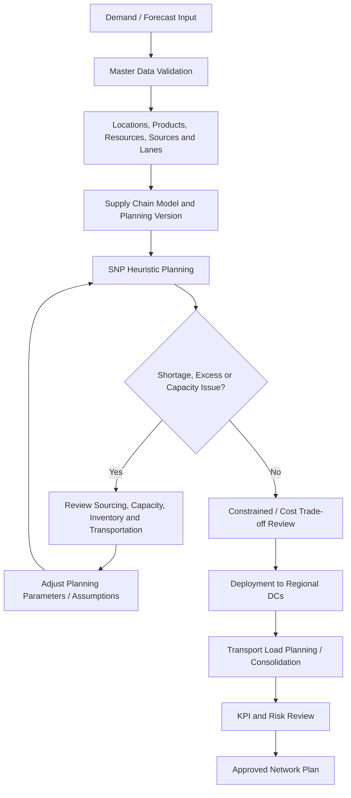

# SAP SCM Planning Flow

## Flow Explanation

1. Demand is captured or simulated by product and region.
2. Planning master data is validated before the supply run.
3. Network objects are included in the relevant supply chain model and planning version.
4. An initial heuristic produces a supply plan.
5. Exceptions such as shortages, overloads, or excess inventory are reviewed.
6. Planning assumptions are adjusted where required.
7. Constrained and cost-based alternatives are evaluated conceptually.
8. Deployment logic determines how supply is allocated downstream.
9. Transportation-load planning reviews shipment consolidation and capacity.
10. KPIs and risk scenarios are reviewed before the plan is accepted.
