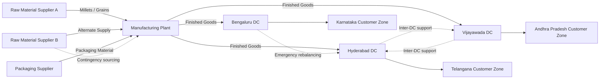

# Supply Chain Network Diagram

## Design Notes

- Two raw-material sources reduce dependency on a single supplier.
- Packaging supply is modeled separately because packaging shortages can stop finished-goods production even when raw materials are available.
- The plant is the central production node.
- Three regional DCs position inventory closer to demand.
- Inter-DC support is shown as a contingency concept for inventory rebalancing.
- Transportation lanes should be maintained only where the movement is operationally valid and economically justified.
